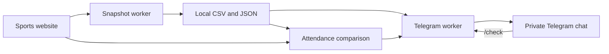

# InnoSport Badminton Bot

[](https://github.com/alberto-de-swerto/innosport-badminton-bot/actions/workflows/tests.yml)
[](https://www.python.org/)
[](LICENSE)

A Python side project for running a university badminton club: save registrations one hour before practice, send the roster to Telegram, and compare it with attendance afterwards.

Built around a real coordination problem at [Innopolis University](https://sport.innopolis.university/). Students sometimes cancel immediately before a full session starts, leaving others with no chance to take the place. A saved roster gives the club leader a reference for reviewing what changed.

## What it does

- **Scheduled snapshots** of Beginners registrations, saved locally as CSV and JSON with the actual capture time.
- **Automatic Telegram notifications** after a successful scheduled export, including every registered participant's name.
- **Attendance comparisons** through `/check`, after the leader saves attendance hours on the website.
- **Interactive SSO sign-in** with a reusable local session. Passwords are entered only on the university login page.
- **Independent background workers** for exports and Telegram, installed as macOS LaunchAgents.
- **Optional VPN handling** through macOS network profiles or Shortcuts, with restoration after requests and recovery after interruption.
- **Persistent state and atomic writes** for retries, restart recovery, and distinguishing missed jobs from successful snapshots.

This is an independent club tool, not an official university service. The website account must already have permission to view the group's participants. User-facing messages are currently in Russian.

## Example

The following notification uses fictional participants:

```text
✅ Список за час до тренировки успешно сохранён
🏸 Beginners · 12.11.2026 20:00 МСК
Выгрузка: 12.11 19:00:05 МСК
Планируют прийти: 3

1. Example Player One
2. Example Player Two
3. Example Player Three

После занятия сохрани часы на сайте и отправь /check.
```

After attendance is marked, `/check` separates the original roster, participants who disappeared without receiving hours, attendees with credited hours, original registrations with zero hours, and later additions. See the [sample comparison](docs/example-report.md).

## How it works



The browser is needed for interactive SSO sign-in. Scheduled exports use Playwright's HTTP request context and the saved sports-site session. The client only reads sports data: it does not register students, cancel places, or assign hours.

The Telegram worker watches completed scheduled exports and sends their saved contents. Telegram outages do not block collection. Reports compare students by stable ID rather than display name.

Read more about [the architecture and reliability decisions](docs/architecture.md).

## Quick start on macOS

Requirements: Python 3.9+ (3.11+ recommended), a sports-site account with trainer access, and a Telegram bot created through [@BotFather](https://t.me/BotFather).

```sh
git clone https://github.com/alberto-de-swerto/innosport-badminton-bot.git
cd innosport-badminton-bot
python3 -m venv .venv
.venv/bin/python -m pip install -r requirements.txt
.venv/bin/python -m playwright install chromium
cp config.example.json config.json
```

Edit `config.json` for your group and timetable. VPN control is disabled in the example. Find the right group and verify access:

```sh
.venv/bin/python sportsite.py login
.venv/bin/python sportsite.py list
```

Sign in through SSO in the opened browser. Put the appropriate group ID in `group_ids`, then run:

```sh
.venv/bin/python sportsite.py check
.venv/bin/python sportsite.py schedule
.venv/bin/python sportsite.py install-autostart
.venv/bin/python sportsite.py telegram-setup
```

Telegram setup asks for the bot token with hidden input and gives you a one-time pairing link. Open it in your Telegram account and press **Start**. Only that private chat can use the bot.

Alternatively, double-click `setup.command`, then `login.command`. Configure the group before installing autostart; open `telegram-setup.command` after installation.

Both workers run independently of the terminal or coding tools. **The Mac must stay on, awake, and online.** The LaunchAgents start when you log in to macOS. The SSO session can expire and require a new interactive login.

See [configuration](docs/configuration.md) and [day-to-day operation](docs/operations.md).

## Default timetable

The example uses `Europe/Moscow` and a 60-minute lead time. All entries are configurable.

| Day | Practice | Snapshot |
| --- | --- | --- |
| Thursday | 20:00 | 19:00 |
| Saturday | 18:30 | 17:30 |
| Sunday | 18:00 | 17:00 |

## Telegram commands

| Command | Result |
| --- | --- |
| `/check` | Compare the most recent session that has started |
| `/check YYYY-MM-DD` | Compare a specific session |
| `/status` | Show recent snapshot jobs and the next scheduled capture |
| `/help` | Show usage instructions |

Save attendance hours on the sports website before calling `/check`. Automatic roster notifications require no command.

## Engineering choices

| Concern | Approach |
| --- | --- |
| A missed deadline must not look like a historical capture | Explicit `saved`, `retry`, and `missed` states; actual request and capture timestamps |
| A process can stop during a write | Write to a temporary location and atomically publish the completed snapshot |
| Workers can overlap | File locks around scheduling and VPN operations |
| Telegram can be unreachable | Separate notification worker with a durable per-message delivery checkpoint |
| Names can change or repeat | Compare student IDs |
| Website data can be inconsistent | Validate group, session time, schema, and pre-session registration count |
| Credentials and rosters are private | Local files with restricted permissions, excluded from Git |

## Testing

```sh
.venv/bin/python -m unittest discover -s tests -v
```

The tests use fictional people, mocked VPN commands, and a local HTTP server. They cover scheduling, SSO/session failures, token transport, atomic exports, missed deadlines, report categories, Telegram pairing and authorization, notification retries, and restart recovery. They do not need real credentials, a Telegram account, or a browser download.

GitHub Actions runs the suite on Linux with Python 3.11 and 3.13. Native macOS integration is tested separately; CI does not validate your VPN, SSO account, or local LaunchAgents.

## Limitations

- The website exposes current registrations and attendance marks, not a complete cancellation history. Cancel-and-rejoin events and cancellations by people with positive hours cannot be identified from this table. The client also cannot tell who removed a registration.
- Zero hours means no attendance credit was saved. It is not independent proof that someone was physically absent.
- The default capture window allows up to 120 seconds of network delay and records the actual time. This is not a transactionally consistent database snapshot.
- A manual export does not replace a missed scheduled snapshot. Explicitly imported reference lists are labelled as user-provided.
- Telegram delivery is retried. A lost acknowledgement after Telegram accepts a message can result in a duplicate.
- The integration depends on the university website's API and permission model. Group IDs may change between semesters.

## Project layout

```text
sportsite.py              API access, SSO, exports, scheduler, and CLI
telegram_bot.py           Private bot, commands, and roster notifications
attendance_report.py      Baseline validation and attendance comparison
vpn_control.py            Optional macOS VPN pause and recovery
api_auth.py               Optional personal InNoHassle token support
config.example.json       Shareable configuration template
tests/                    Unit and local HTTP integration tests
docs/                     Setup details and fictional examples
```

See [SECURITY.md](SECURITY.md) for credential handling and publication boundaries, and [CONTRIBUTING.md](CONTRIBUTING.md) for development notes.

## Acknowledgements and license

The integration was developed by studying the public [InnoSport source](https://github.com/one-zero-eight/sport). It uses [Playwright](https://playwright.dev/python/docs/auth) and the [Telegram Bot API](https://core.telegram.org/bots/api). Those projects and services retain their own licenses and terms.

This project's code is available under the [MIT License](LICENSE).
