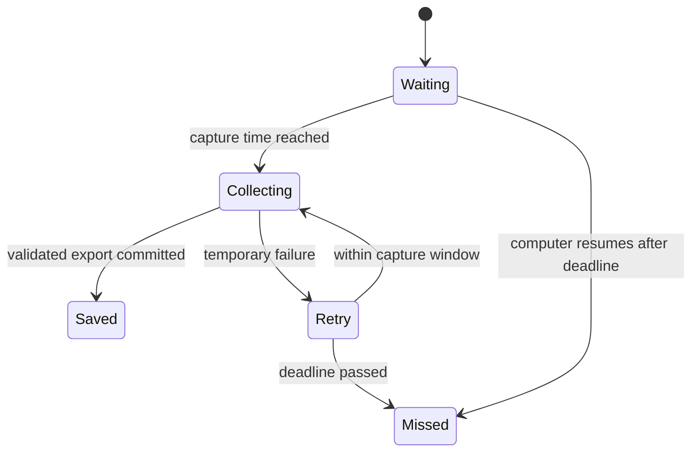

# Architecture and reliability

## Sports-site access

`sportsite.py` wraps read-only JSON endpoints used by the university website:

- `GET /api/calendar/trainings` locates a session by date, time, and group.
- `GET /api/attendance/{training_id}/grades` reads the trainer's participant table.
- `GET /api/training/{training_id}` validates the session and registration count.

SSO is completed manually in a browser. Afterwards, a Playwright HTTP request
context loads only the sports-site session. Cookies for the SSO provider are not
retained. A session expiry produces an authentication error and requires login.

The participant table is the union of registrations and attendance marks. Before
practice, the exporter checks that its row count agrees with registration load.
This catches many inconsistent reads, but the requests do not form a database
transaction.

## Snapshot worker

The scheduler derives capture times from the configured practice timetable.
It uses `.state/jobs.json` and a file lock to coordinate retries and restarts:

CSV and JSON are written to a private temporary directory, then renamed into the
final export directory. A restarted worker can recognize a completed export if
it stopped before updating the job journal. Manual snapshots have a distinct
mode and filename and do not satisfy scheduled jobs.

## Telegram worker

`telegram_bot.py` receives commands through long polling and also watches
completed scheduled exports. It is a separate process from the snapshot worker,
so messaging outages do not delay roster collection.

Only the paired private chat can invoke commands. Update offsets are persisted.
Old commands request resubmission rather than silently comparing the wrong day.

Roster notifications use the saved snapshot, never a later website read. Their
delivery journal records a snapshot digest and progress through message parts.
Retries resume from the first unconfirmed part. A lost acknowledgement after
server acceptance can still result in a duplicate; delivery is not exactly once.

The worker also accepts inline button callbacks, with the same private-chat and
owner checks as text commands. Callback data contains stable student IDs and a
digest of the currently listed cases, rather than names or positions in a table.
A stale removal button refreshes the list without dismissing newer cases.

`bot_notifications.py` runs alongside roster notifications with an independent
retry timer. It reads capture jobs, startup health, saved snapshots, and final
reports without calling the sports website. Per-event delivery checkpoints
deduplicate errors, missed jobs, and reminders across restarts. A final report
suppresses the reminder; a three-hour window prevents stale reminder floods.
The snapshot keeps a validated calendar end when available; older files use the
configured duration. Startup failures and typed retry causes are persisted by
the exporter so the Telegram process can explain failures even after it exits.

## Attendance comparison

`attendance_report.py` selects the most recent started session, or an explicitly
requested date. It validates the baseline and compares stable student IDs with
the current credited-hours table. Reports are stored separately from snapshots.

When a scheduled baseline is missing, the client does not substitute an ordinary
manual export. An explicitly user-provided historical list can be stored as a
labelled `user_import` with separate reference and import times. This does not
change the original job's missed status. There is no screenshot OCR importer;
such input must be transcribed and identities verified separately.

## Late cancellation register

`violation_registry.py` consumes completed comparisons of scheduled snapshots.
Cases are keyed by group, session, and student ID. The latest comparison replaces
the session's cases, so repeated checks do not increase counts and corrected
attendance removes outdated cases. Existing final reports are backfilled on
`/violations`; preliminary and user-imported reports are excluded from automatic
counting. Individual imported cases require explicit owner confirmation through
`confirm_import`; their origin and confirmation time are preserved separately.

The register uses a separate file lock and atomic JSON writes. The −1 button
dismisses the oldest active case; a zero counter removes the person from the view.
Removing a person dismisses all their current cases. Tombstones prevent rechecks
or backfills from resurrecting forgiven cases. The current source cases remain
separate from their visibility, allowing undo to respect newer attendance
corrections. New sessions remain eligible.
Neither dismissal nor backfill modifies snapshots, source reports, or the site.

The register retains the last 20 reversible edits, including the affected cases
and their source. `/undo` restores only those cases instead of rolling the whole
file back, preserving concurrent new cases and newer website corrections. Undo
requests are checkpointed to prevent a retried update from undoing another edit.
Old callback IDs cannot undo a different latest action. Edits made before this
history existed cannot be undone from the new command.

The comparison cannot reconstruct a cancellation timeline, identify who removed
a booking, or establish physical presence independently of saved hours.

## VPN recovery

`vpn_control.py` holds a lock while pausing and restoring registered profiles.
It writes the restoration journal before disconnecting. Both normal cleanup and
the scheduler's recovery loop attempt to restore unfinished connections.

## Optional token authentication

`api_auth.py` supports a personal InNoHassle credential scoped to the owner's
sport account. The accounts service exchanges it for a short-lived sports-site
token. The long-lived key is sent only to the accounts service. This optional
mode is not enabled by adding the code, does not renew its own long-lived key
forever, and retains the service-side permissions of the owner's credential.

The baseline integration was studied against the public
[InnoSport source](https://github.com/one-zero-eight/sport) and
[InNoHassle Accounts source](https://github.com/one-zero-eight/accounts).
