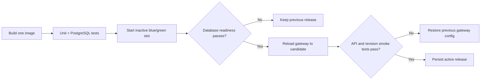

# Demo release pipeline

The demo is a read-only HTTP application with fictional participants, PostgreSQL,
and a local Nginx gateway. It never signs into the university website and contains
no Telegram setup or real session. `/`, `/api/violations` and `/api/audit` show the
same register/domain logic used by the bot. `/health/live` checks the HTTP process;
`/health/ready` verifies database access, schema revision and the demo dataset.

Live and demo databases have explicit dataset markers. The demo refuses a live
database; the real bot refuses a demo database. `.dockerignore` is a source
allowlist, preventing credentials and real reports from entering the build context.
The application runs as an unprivileged user with a read-only root filesystem.
Python, PostgreSQL and Nginx images are pinned by digest.

## Run locally

Requirements: Docker Engine with Compose v2+, Bash, and host Python 3. No real
credentials or university network connection are needed.

```sh
docker build -f Dockerfile.demo --build-arg APP_REVISION=local-demo -t innosport-demo:local .
bash scripts/deploy_demo.sh innosport-demo:local
```

Open `http://127.0.0.1:8080`. The script creates a private random database password
in `deploy/.env`; retain it with the database volume. `DEMO_PORT`, `DEMO_PROJECT`,
`DEPLOY_STATE_DIR`, and `DEMO_ENV_FILE` customize the local deployment. On macOS,
choose a state directory shared with the Docker VM, outside protected Downloads
folders, for example `$HOME/.local/share/innosport-demo`.

The demo's PostgreSQL volume is separate from the bot's live database. The gateway
binds only to loopback. Public hosting requires an HTTPS reverse proxy on the host;
no public port or domain is created automatically.

## Promotion and rollback



The previous slot stays running while the candidate starts. The deploy script
holds a deployment lock, waits for PostgreSQL and candidate readiness, switches
the gateway, then checks the actual served revision, fictional counts and audit.
Only a successful smoke check updates the active-release marker. Failed readiness
leaves traffic unchanged; failed post-switch checks restore the previous gateway
configuration and report rollback failures explicitly. A first deployment has no
previous release to restore. The last slot is retained for rollback.

Application rollback preserves the database volume and never runs destructive
schema downgrades. Releases must use backward-compatible schema changes for
automatic rollback; a future incompatible migration needs a separate migration
and recovery plan. The current demo uses one schema revision. A deployment lock
left by abrupt host loss requires checking the running containers before removing
the stale `deploy.lock` directory.

Run the real-container regression locally:

```sh
bash scripts/test_deployment.sh innosport-demo:local
```

It promotes two distinguishable revisions, rejects an image that cannot become
ready, injects a post-switch smoke failure, and verifies the previous revision and
its database contents after both failures. Its isolated containers/volume are
removed afterwards. A persistent production/demo volume is not touched.

## GitHub Actions and server setup

On pull requests and `main`, Actions runs the Python matrix, a real PostgreSQL
integration job, and container deployment/rollback tests. On successful `main`
builds, the exact tested image is pushed to
`ghcr.io/alberto-de-swerto/innosport-badminton-demo` with the commit tag. Deployment
uses its immutable digest, not a mutable `latest` tag. The current published image
targets Linux amd64; a local build also supports the host architecture.

The server deployment job remains skipped until repository variable `DEMO_HOST`
is configured. With no server, tests and image publication still work.

When a server is available:

1. Install Docker Engine, Compose and Python 3. Give a dedicated deployment user
   access to Docker and a writable deployment directory. Docker access is powerful;
   use that account only for deployment.
2. Ensure the server can pull the GHCR package. New GHCR packages may be private;
   either explicitly make this fictional demo image public in package settings or
   authenticate Docker on the server with a read-only package credential.
3. Add repository **variables** `DEMO_HOST`, `DEMO_USER`, `DEMO_DIR` (an absolute
   path such as `/srv/innosport-demo`). Hostname/IP, username and directory are
   validated before use. Default SSH port 22 is used.
4. Create GitHub environment `demo` and add **secrets** `DEMO_SSH_KEY` and
   `DEMO_KNOWN_HOSTS`. Obtain and verify the server's SSH host-key fingerprint
   independently; the workflow does not trust a key discovered during deployment.
5. Configure host HTTPS routing to `127.0.0.1:8080` if public access is wanted.
   Set environment protection rules as appropriate for the server.

The workflow serializes deployments, rejects commits superseded on `main`,
transfers only Compose/probe/deploy tooling, and starts the tested digest through
SSH. Secrets never enter the image. There is no remote deployment until those
server settings exist; the workflow does not provision paid infrastructure.
